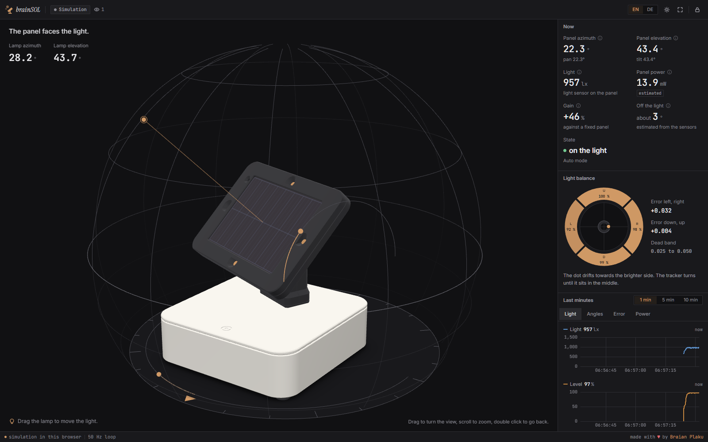

<p align="center">
  
</p>

<h1 align="center">brainSOL</h1>

<p align="center">
  The web page of a small dual axis solar tracker: a live 3D twin, the numbers and the charts.<br/>
  Without a tracker it runs the same tracking loop as a simulation in the browser.<br/>
  Live at <a href="https://sol.swimmingbrain.dev">sol.swimmingbrain.dev</a>
</p>

<p align="center">
  
</p>

## Run it locally

You need Node 20 or newer and pnpm.

```bash
pnpm install
pnpm dev
```

Then open http://localhost:5173.

## Connect a tracker

The Pi side is [brainsolpi](https://github.com/swimmingbrain/brainsolpi). Give the page its address in `static/config.json`, the default for everyone, empty means the simulation:

```json
{ "pi": "wss://brainsol.<tailnet>.ts.net" }
```

Or for one visit with `?pi=` in the page address, which wins over the file: `https://sol.swimmingbrain.dev/?pi=brainsol.<tailnet>.ts.net`.

A page loaded over https can only reach a `wss` address, so a plain `ws://` Pi on the local network works only from http, like `http://localhost:5173/?pi=brainsol.local`.

## Admin tools

Click the lock icon in the top bar. The simulation needs no PIN, a real tracker asks for the one you set on the Pi with `brainsolpi setpin`.

## Deploy

Push to `main`, `.github/workflows/deploy.yml` checks, tests and builds the page and puts it on GitHub Pages. The custom domain is in `static/CNAME`.

## Check, test, build

```bash
pnpm check   # type checks, 0 errors
pnpm test    # unit tests
pnpm build   # static site in build/
```

## License

MIT, see [LICENSE](LICENSE). The libraries and the font keep their own licenses, listed in [THIRD_PARTY_LICENSES](THIRD_PARTY_LICENSES).
