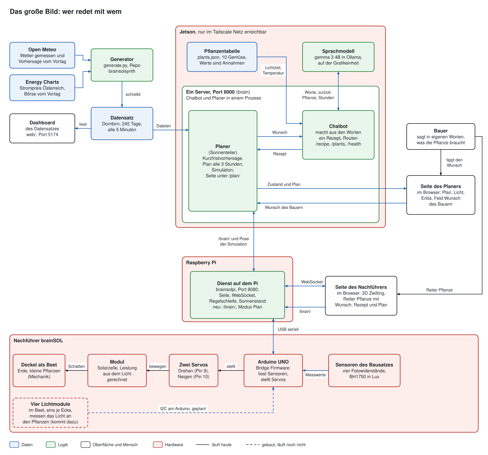
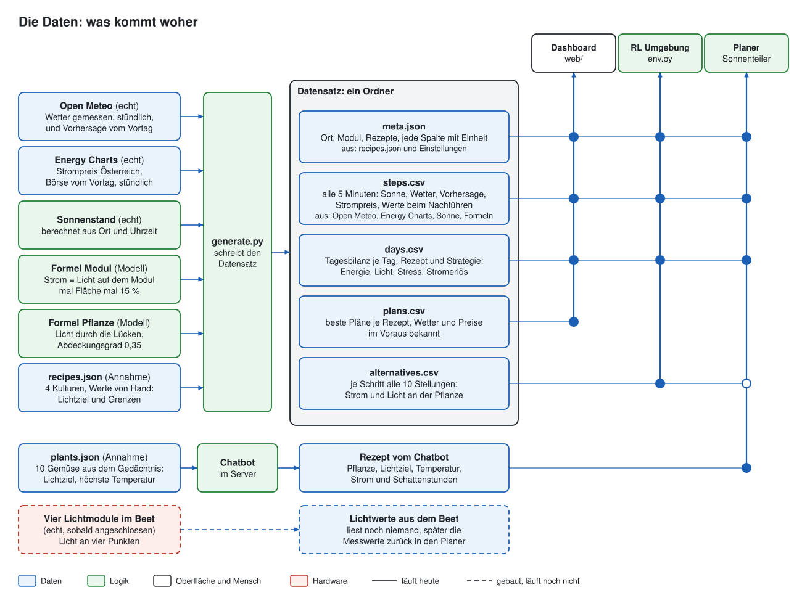
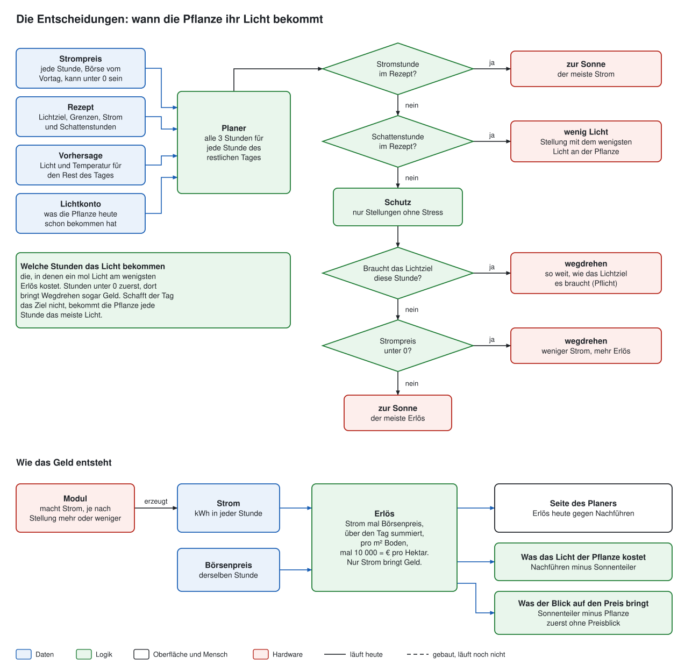
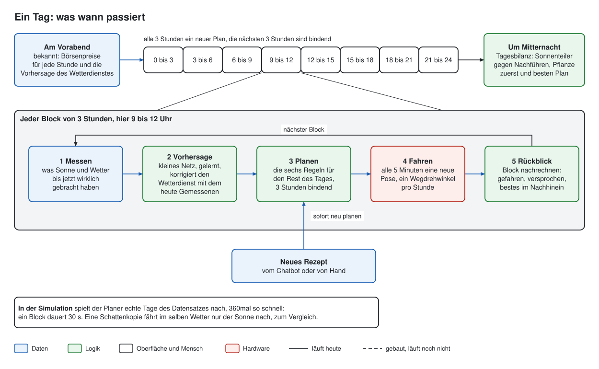
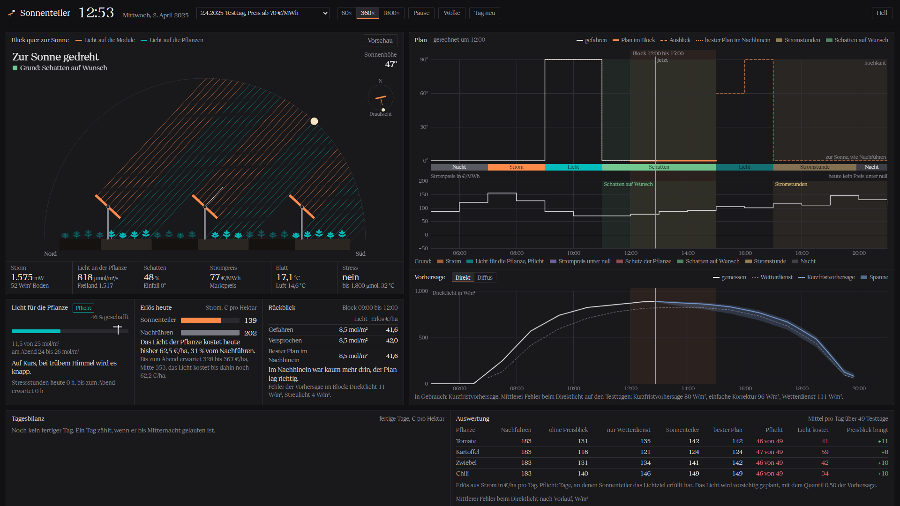

# Sonnenteiler im Überblick

Über einem Beet steht ein Solarmodul auf einem Nachführer.
Was auf das Modul fällt, wird Strom, was daran vorbei durchfällt, bekommt die Pflanze.
Die Geschichte in einem Satz: **Die Pflanze bekommt ihr Licht als Pflicht, der Strompreis entscheidet, wann, alles andere wird Strom.**
Der Bauer sagt in eigenen Worten, was seine Pflanze braucht, ein Chatbot macht daraus ein Rezept, und der Planer Sonnenteiler legt alle 3 Stunden fest, wie weit sich das Modul von der Sonne wegdreht.
Geld bringt nur der verkaufte Strom: "Erlös" heißt hier immer Stromerlös.
Unser Beitrag zur Challenge AI4Green, Thema Agri PV.

**So sind die Bilder zu lesen.** Die Farbe sagt, was für ein Ding ein Kasten ist, die Linie sagt, ob es schon läuft.

| | heißt |
|---|---|
| Blau | Daten: Quellen, Dateien, Tabellen und was als Daten reist (Rezept, Plan, Messwerte, Preise) |
| Grün | Logik: Programme, die rechnen oder entscheiden (Generator, Planer, Chatbot, Sprachmodell, Dienst auf dem Pi) |
| Schwarz | Oberfläche und Mensch: die Seiten im Browser und die Menschen davor, dazu Text und neutrale Rahmen |
| Rot | Hardware: Nachführer, Servos, Sensoren, Modul, Beet und die Rechner Raspberry Pi und Jetson |
| durchgezogene Linie | läuft heute |
| gestrichelte Linie oder gestrichelter Rahmen | gebaut, läuft aber noch nicht |

Ein Pfeil ist blau, wenn auf ihm Daten reisen, sonst schwarz. Was nur angenommen ist, steht als Wort im Kasten ("Annahme").

## 1. Das große Bild: wer redet mit wem

| Teil | was es tut | läuft wo | Repo und Zweig |
|---|---|---|---|
| Generator und Datensatz | `generate.py` baut aus Wetter, Strompreisen und den Formeln den Datensatz, dazu ein Dashboard (`web/`) und eine RL Umgebung (`env.py`). Teammitglied Daten | Rechner des Teams, der Datensatz liegt auf dem Jetson | `brainsolsynth`, die neue Fassung im lokalen Zweig `no-crop-prices`, noch nicht committet |
| Server ("brain") | Chatbot und Planer in einem Prozess. Teammitglieder Chatbot und Vorhersage und Plan | Jetson, Port 8000 | `swimmingbrain/brainsol`, Ordner `server/`, Arbeitskopie `brainsol-farm`, Zweig `feat/farm`, noch nicht committet |
| darin der Chatbot | macht aus den Worten des Bauern ein Rezept. Das Sprachmodell liest nur Pflanze und Stunden, die Zahlen kommen aus der Pflanzentabelle `plants.json`. Routen `/recipe`, `/plants`, `/health` | | `server/brain/` |
| darin der Planer (Sonnenteiler) | Kurzfristvorhersage, Plan alle 3 Stunden, Simulation, eigene Seite unter `/plan/` mit dem Feld "Wunsch des Bauern", Routen unter `/plan/api/` | | `server/sonnenteiler/`. Der Ordner `sonnenteiler` neben den Repos ist nur noch die ältere Kopie |
| Sprachmodell | gemma 3 mit 4 Milliarden Parametern, nur Text, 4 bit, in Ollama | Jetson, auf der Grafikeinheit | |
| Dienst auf dem Pi | Regelschleife, Sonnenstand, Simulation, liefert die Seite des Nachführers und spricht mit ihr über WebSocket. Neu: Weiterleitung `/brain/` zum Jetson und der Modus "Plan" | Raspberry Pi, Port 8080 | `swimmingbrain/brainsolpi`, das Neue im Zweig `feat/brain`, noch nicht committet |
| Seite des Nachführers | 3D Zwilling, Zahlen, Admin Werkzeuge. Neu: Reiter "Pflanze" mit Wunsch, Rezept, dem Plan des Tages mit Stunden und Gründen und einem Link zur ganzen Seite des Planers, dazu der Knopf für den Modus "Plan" | Browser, die Seite liefert der Pi | `swimmingbrain/brainsol`, die neue Seite in `brainsol-farm` (`src/`), noch nicht committet |
| Nachführer | Arduino UNO mit Bridge Firmware, zwei Servos (Drehen und Neigen), die Sensoren des Bausatzes (vier Fotowiderstände für das Nachführen und ein BH1750 für das Licht auf dem Modul), Modul. Im Deckel das Beet (Teammitglied Mechanik) | am Pi über USB | Firmware in `brainsolpi` |
| Vier Lichtmodule im Beet | je eines in einer Ecke des Deckels, in der Erde. Sie messen, was an Licht bei den Pflanzen ankommt, und zeigen, welcher Teil des Beets im Schatten liegt. Werte über I2C | kommen gerade dazu, noch liest sie keine Software | |

**Läuft heute, im Bild durchgezogen:** der eine Server auf dem Jetson, Port 8000.
Ein Wunsch an `POST /recipe` kam in 7 s als Rezept zurück, zusammen mit dem Plan für den Rest des Tages.
Aus "Tomaten, vertragen keine pralle Mittagssonne. Ab 17 Uhr brauche ich Strom." wurde dabei ein Rezept mit Schattenstunden von 11 bis 15 und Stromstunden von 17 bis 21 Uhr.
Auf der Seite des Planers tippt der Bauer seinen Wunsch in das Feld, der Planer gibt ihn im selben Prozess an den Chatbot und plant sofort neu.
Das Sprachmodell hat auf dem Jetson 18 der 19 Testsätze des Chatbots richtig gelesen, im Mittel in 5,3 s pro Anfrage.
Ein kleineres Modell auf den Prozessorkernen (qwen 2.5 mit 3 Milliarden Parametern) schaffte 14 von 19 in 13 s und fiel raus.
Mit geladenem Modell bleibt auf dem Jetson nur etwa 1 GB Speicher frei.

Auf dem Pi laufen seit einem Neustart auch die neuen Teile, geprüft am echten Gerät:

* **Weiterleitung:** die Seite des Nachführers spricht nur mit dem Pi, der Pi reicht alles unter `/brain/` an den Jetson weiter. `/api/info` des Pi meldet `"brain": true`, `/brain/health` antwortet über den Pi mit 200.
* **Modus "Plan":** der Nachführer fährt, was die Simulation des Planers gerade fährt. Der Pi fragt etwa einmal pro Sekunde nach der Pose und stellt den Kopf dorthin. Beim Prüfen meldete der Dienst, dass er dem Plan folgt (simulierter 16. Juli 2025, 6:25 bis 6:44 Uhr, 90 Grad weggedreht für die Lichtpflicht), und die gemeldete Pose folgte den Zielen (Drehen 63 bis 67 Grad, Neigen 85 bis 82 Grad). Gefahren wird mit dem echten Bausatz, nicht mit der Simulation des Pi. Das sagt der Dienst, die Servos selbst hat dabei niemand beobachtet.
* **Reiter "Pflanze"** und der Knopf für den Modus: der Pi liefert die neue Seite aus und ihre Routen antworten. Im Browser angesehen wurde der Reiter dabei noch nicht.

**Kommt gerade dazu, im Bild gestrichelt:** die vier Lichtmodule im Beet.
Noch liest sie keine Software: nicht die Firmware des Arduino, nicht der Dienst auf dem Pi, keine Seite zeigt sie, der Planer bekommt sie nicht.
Geplant ist, sie an den I2C Bus des Arduino zu hängen, an dem schon der BH1750 des Bausatzes sitzt, entschieden ist das nicht.
Wichtig sind sie, weil der Planer das Licht an der Pflanze nur mit einer Formel als Mittel über den Boden rechnet.
Die Module messen es an vier Punkten des echten Beets: am Prototyp zeigen sie, wie der Schatten über das Beet wandert, wenn sich das Modul dreht, und ihr Mittel ist das gemessene Gegenstück zum gerechneten Licht an der Pflanze.

**Nicht verbunden und nicht gebaut:** Messwerte des echten Nachführers zurück in den Planer.
Geplant wird immer auf dem simulierten Tag, der Nachführer spiegelt ihn nur.
Die vier Lichtmodule wären später die natürliche Quelle dafür, ein Lichtkonto mit echten Werten.

Der Jetson ist nur in seinem Tailscale Netz erreichbar, die öffentliche Seite des Nachführers erreicht den Pi über eine https Adresse (Tailscale Funnel).
Wer nicht in diesem Netz ist, startet den Server lokal im Ordner `server/` mit `uv run python -m sonnenteiler serve --data <ordner> --work <ordner> --port 8000` und öffnet http://localhost:8000/plan/.

## 2. Die Daten: was echt ist, was angenommen

| was | woher | echt oder angenommen |
|---|---|---|
| Sonnenstand | aus Ort und Uhrzeit berechnet | echt |
| gemessenes Wetter: Direktlicht (`dni`), diffuses Licht (`dhi`), Temperatur, Bewölkung | Archiv von Open Meteo, stündlich, Dornbirn, 1. März bis 31. Oktober 2025 | echt |
| Vorhersage des Wetterdienstes vom Vortag (`fc_*`) | Open Meteo | echt, mit echten Fehlern: auf den Testtagen beim Direktlicht im Mittel 111 W/m² daneben, das Direktlicht hat bei Tag im Mittel etwa 378 W/m² |
| Strompreis | Börsenpreis vom Vortag für Österreich, Energy Charts (Fraunhofer ISE), je Stunde | echt: von −253 bis 508 €/MWh, im Mittel 86 €/MWh, in 11 % der Schritte bei Tag unter null |
| Strom des Moduls | Formel der Simulation von brainSOL: Licht auf dem Modul mal Fläche mal 15 % | Modell |
| Licht an der Pflanze | Formel mit dem Abdeckungsgrad 0,35: die Module nehmen Direktlicht nach ihrer Fläche weg | Modell, ein Mittel über den Boden |
| Lichtziel und Grenzen der Pflanze | `recipes.json` (4 Kulturen) und `plants.json` (10 Gemüse) | Annahme, Werte von Hand |
| Hochrechnung auf einen Hektar | das kleine Modul des Bausatzes über den Abdeckungsgrad hochgerechnet | Annahme |
| Licht in der Erde des Beets, an vier Punkten | vier Lichtmodule in den Ecken des Deckels, über I2C | echt, sobald angeschlossen. Heute liest sie noch niemand |

Wer welche der fünf Dateien liest, zeigt das Bild, `meta.json` erklärt jede Spalte mit Einheit.
Der Planer prüft seine Formeln gegen `alternatives.csv`: 10848 Zeilen, größter Unterschied 0,018 mW.
Der Datensatz auf dem Jetson stammt noch vom alten Generator und hat ein paar Spalten mehr, der Planer liest nur die, die er braucht.

### Zwei Tabellen mit Zahlen zur Pflanze

`recipes.json` (Teammitglied Daten) hat 4 Kulturen mit Lichtziel, Lichtgrenze, Temperaturgrenze für das Blatt und Stromstunden, damit ist der Datensatz gerechnet.
`plants.json` (Teammitglied Chatbot) hat 10 Gemüse mit Lichtziel und höchster Temperatur, jede Zeile ist dort als ungeprüft und aus dem Gedächtnis markiert.
Die vier, die in beiden stehen (Lichtziel in mol/m² pro Tag):

| Kultur | Lichtziel `recipes.json` | Lichtziel `plants.json` | Temperatur `recipes.json` (Blatt) | höchste Temperatur `plants.json` | Lichtgrenze `recipes.json` |
|---|---|---|---|---|---|
| Tomate | 25 | 25 | 33 °C | 32 °C | 1800 µmol/m²/s |
| Kartoffel | 30 | **17** | 30 °C | **27 °C** | 2000 µmol/m²/s |
| Zwiebel | 25 | **17** | 32 °C | **30 °C** | 2000 µmol/m²/s |
| Chili | 25 | **20** | 32 °C | 32 °C | 1500 µmol/m²/s |

Nur in `plants.json`: Okra (20 mol/m², 35 °C), Aubergine (20, 32), Knoblauch (15, 28), Erbsen (15, 25), Bockshornklee (12, 30), Elefantenfuß Yams (15, 35).
Für ein Rezept vom Chatbot kommen Lichtziel und Temperatur aus `plants.json`, die Lichtgrenze aus `recipes.json` derselben Kultur, sonst von der Tomate (1800 µmol/m²/s).
Das ist wichtig, weil das Lichtziel jetzt eine Pflicht ist: ein kleineres Ziel kostet weniger Strom (Zahlen dazu in Abschnitt 3).
Welche Tabelle am Ende gilt, ist offen.

## 3. Die Entscheidungen und das Geld

Für jede Stunde des Tages gilt, in dieser Reihenfolge:

1. **Stromstunde** im Rezept: die Stellung mit dem meisten Strom, der Bauer braucht ihn.
2. **Schattenstunde** im Rezept: die Stellung mit dem wenigsten Licht an der Pflanze.
3. **Schutz:** nur Stellungen, die die Pflanze nicht stressen (zu viel Licht oder ein zu warmes Blatt, Blatt = Luft plus 3 °C je 1000 µmol/m²/s).
4. **Lichtpflicht:** über den Tag bekommt die Pflanze ihr Lichtziel. Das Licht wird in den Stunden gegeben, in denen ein mol am wenigsten Erlös kostet, Stunden mit einem Preis unter null zuerst, dort bringt Wegdrehen sogar Geld.
5. **Alles andere ist Strom:** bei positivem Preis zur Sonne, bei negativem weggedreht.
6. **Schafft der Tag das Ziel nicht**, geht die Pflanze den ganzen Tag vor: jede Stunde die erlaubte Stellung mit dem meisten Licht.

**Das Geld:** Erlös = Strom jeder Stunde mal Börsenpreis dieser Stunde, pro m² Boden. Die Seite zeigt € pro Hektar (mal 10 000).
Kosten der Anlage, Gebühren und Netzentgelte sind nicht abgezogen.
Verglichen wird immer im selben Wetter:

| Strategie | was sie ist |
|---|---|
| Nachführen (`tracking`) | immer zur Sonne: der meiste Strom, die Pflanze zählt nicht |
| Pflanze zuerst ohne Preisblick (`blind`, im Datensatz `oracle`) | schafft das Lichtziel mit der meisten Energie, schaut nicht auf den Preis, Wetter im Voraus bekannt |
| Sonnenteiler (`plan`) | die sechs Regeln mit der Vorhersage, alle 3 Stunden neu geplant |
| bester Plan (`best`) | die sechs Regeln mit bekanntem Wetter, die Latte für Sonnenteiler |
| nur Wetterdienst (`raw`) | wie Sonnenteiler, aber nur mit der Vorhersage des Wetterdienstes |

Zwei Zahlen erzählen die Geschichte: **was das Licht der Pflanze kostet** = Nachführen minus Sonnenteiler, und **was der Blick auf den Preis bringt** = Sonnenteiler minus Pflanze zuerst ohne Preisblick.

### Zwei Tage durchgerechnet (Tomate, Lichtziel 25 mol/m²)

**1. Juni 2025, Preise unter null.** Von 9 bis 18 Uhr liegt der Preis unter null, 9 Stunden lang.
In der Stunde von 13 bis 14 Uhr (−12,93 €/MWh) bringt das Modul zur Sonne 470,8 kWh/ha und damit −6,09 €/ha, um 90 Grad weggedreht 89,6 kWh/ha und −1,16 €/ha.
Wegdrehen bringt also 4,93 €/ha, und die Pflanze bekommt 5,57 statt 3,72 mol/m².
Über den Tag: Nachführen −5,5 €/ha (das Ziel knapp geschafft, 25,18 mol/m²), Sonnenteiler und bester Plan 12,5 €/ha mit 36,0 mol/m².
Das Licht der Pflanze kostet hier nichts, es bringt 18,0 €/ha.

**7. April 2025, Licht in den billigen Stunden.** Alle Preise des Tages sind positiv, bei Sonne zwischen 43,92 €/MWh am Mittag und 174,98 €/MWh am Abend.
Reines Nachführen brächte 482,8 €/ha, aber nur 20,27 von 25 mol/m², die Pflicht wäre verfehlt.

| Stunde | Preis | zur Sonne | 90 Grad weggedreht | 1 mol/m² mehr Licht kostet | Plan |
|---|---|---|---|---|---|
| 9 bis 10 | 109,25 €/MWh | 47,73 €/ha, 0,86 mol/m² | 4,57 €/ha, 2,77 mol/m² | 22,5 €/ha | zur Sonne |
| 12 bis 13 | 43,92 €/MWh | 23,42 €/ha, 3,07 mol/m² | 2,34 €/ha, 5,40 mol/m² | 9,1 €/ha | 90 Grad weg |
| 13 bis 14 | 44,66 €/MWh | 23,95 €/ha, 3,22 mol/m² | 2,40 €/ha, 5,56 mol/m² | 9,2 €/ha | 90 Grad weg |
| 14 bis 15 | 60,70 €/MWh | 32,22 €/ha, 3,02 mol/m² | 3,19 €/ha, 5,34 mol/m² | 12,5 €/ha | 20 Grad weg (Sonnenteiler 30) |
| 18 bis 19 | 129,14 €/MWh | 41,55 €/ha, 0,28 mol/m² | 3,97 €/ha, 1,32 mol/m² | 36,0 €/ha | zur Sonne |

Das fehlende Licht wird am Mittag gegeben, wo es ein Viertel dessen kostet wie am Abend.
Über den Tag: Nachführen 482,8 €/ha (Pflicht verfehlt), Pflanze zuerst ohne Preisblick 396,7 €/ha, Sonnenteiler 436,2 €/ha (25,24 mol/m²), bester Plan 438,4 €/ha.
Das Licht der Pflanze kostet an diesem Tag 46,5 €/ha, der Blick auf den Preis bringt 39,5 €/ha davon zurück.

### Ergebnisse auf den 49 Testtagen

Die Testtage hat die Vorhersage nie gesehen.
Geplant wird das Licht vorsichtig mit dem Quantil 0,35 der Vorhersage (siehe unten).
Mittel pro Tag, Erlös in €/ha:

| Kultur | Nachführen | Pflanze zuerst ohne Preisblick | nur Wetterdienst | Sonnenteiler | bester Plan | Pflicht erfüllt an Tagen (Nachführen, ohne Preisblick, Sonnenteiler, bester Plan) | Licht kostet | Preisblick bringt | erfasst |
|---|---|---|---|---|---|---|---|---|---|
| Tomate | 182,9 | 131,1 | 136,0 | 139,0 | 142,3 | 12, 49, 48, 49 | 43,9 | 7,9 | 70,9 % |
| Kartoffel | 182,9 | 115,9 | 118,3 | 119,9 | 124,5 | 3, 49, 48, 49 | 63,0 | 4,0 | 47,2 % |
| Zwiebel | 182,9 | 130,9 | 135,0 | 138,6 | 141,9 | 12, 49, 49, 49 | 44,3 | 7,7 | 69,9 % |
| Chili | 182,9 | 139,6 | 143,3 | 146,2 | 149,2 | 12, 49, 49, 49 | 36,7 | 6,7 | 69,0 % |

"Erfasst" ist der Anteil der Lücke zwischen "Pflanze zuerst ohne Preisblick" und dem besten Plan, den Sonnenteiler schließt.

* Das Licht der Pflanze kostet 36,7 bis 63,0 €/ha am Tag, ein Fünftel bis ein Drittel dessen, was reines Nachführen verdient.
* Sonnenteiler erfüllt die Pflicht an 48 oder 49 der 49 Tage, reines Nachführen nur an 3 bis 12.
* Der Blick auf den Preis holt 4,0 bis 7,9 €/ha am Tag zurück.

**Wie vorsichtig?** Mit allen vier Kulturen auf allen Testtagen (196 Paare aus Tag und Kultur):

| Quantil der Vorhersage | Erlös | Pflicht im Mittel erfüllt | Tage erfüllt |
|---|---|---|---|
| 0,50 (mittlerer Himmel) | 139,0 | 99,52 % | 185 von 196 |
| 0,35 (vorsichtig, gewählt) | 135,9 | 99,88 % | 194 von 196 |
| 0,25 | 133,6 | 99,62 % | 184 von 196 |
| bester Plan | 139,5 | 100 % | 196 |

Das Team plant mit 0,35: 3,1 €/ha am Tag weniger, dafür ist die Pflicht an 9 Tagen mehr ganz erfüllt.

**Wie viel das Lichtziel ausmacht**, über alle 245 Tage mit bekanntem Wetter (Tomate):
Nachführen verdient 187,9 €/ha und schafft 25 mol/m² an 49 Tagen.
Der beste Plan schafft sie an 150 Tagen, mehr geht an keinem Tag, und verdient 142,7 €/ha.
Mit einem Ziel von 17 mol/m² sind es 129 und 188 Tage, der beste Plan verdient dann 170,4 €/ha.

## 4. Ein Tag Schritt für Schritt

1. **Am Vorabend** sind die Börsenpreise jeder Stunde und die Vorhersage des Wetterdienstes bekannt.
2. **Alle 3 Stunden** (0, 3, 6, ... 21 Uhr) und sofort bei einem neuen Rezept:
   * **Messen:** was das Wetter bis jetzt wirklich war.
   * **Vorhersage** für den Rest des Tages, mit einer Spanne für einen schlechten, mittleren und guten Himmel.
   * **Planen** mit den sechs Regeln für den Rest des Tages, die nächsten 3 Stunden sind bindend.
   * **Fahren:** alle 5 Minuten eine neue Pose, weil die Sonne wandert, aber nur ein Wegdrehwinkel pro Stunde.
   * **Rückblick** auf den Block: gefahren, versprochen, das Beste mit dem echten Wetter.
3. **Um Mitternacht** die Tagesbilanz: Sonnenteiler gegen Nachführen, Pflanze zuerst ohne Preisblick und den besten Plan.

Gelernt ist nur die Kurzfristvorhersage: ein kleines neuronales Netz korrigiert die Vorhersage des Wetterdienstes mit dem, was heute schon gemessen wurde, trainiert auf 196 Tagen, geprüft auf 49.
Mittlerer Fehler beim Direktlicht auf den Testtagen: Wetterdienst 111 W/m², einfache Korrektur 96 W/m², Netz 80 W/m², für 30 Minuten voraus 111, 44 und 32 W/m².
Alles andere ist gerechnet: der Plan, das Geld, die Simulation.
Die Simulation spielt echte Tage des Datensatzes 360mal so schnell nach, ein Block dauert 30 s, und eine Schattenkopie fährt im selben Wetter nur der Sonne nach.

## 5. Wo man was sieht

Im Bild läuft ein Rezept mit Schattenstunden am Mittag und Stromstunden am Abend.
Die Auswertung unten rechts im Bild ist noch mit dem mittleren Himmel (0,50) gerechnet, die Tabelle oben mit 0,35.

| Bereich | was man dort sieht |
|---|---|
| Kopf | Uhr der Simulation, Wahl des Tages, Tempo, Pause, Wolke, Tag neu |
| links oben | Module und Pflanzen quer zur Sonne, wie weit weggedreht und warum, darunter Strom, Licht an der Pflanze, Schatten, Strompreis, Blatt, Stress |
| rechts oben | der Plan über den Tag: gefahren, bindender Block, Ausblick, bester Plan im Nachhinein, der Grund je Stunde als Band, Strom und Schattenstunden, darunter der Strompreis |
| rechts Mitte | Vorhersage: gemessen, Wetterdienst, Kurzfristvorhersage mit Spanne |
| links Mitte | Licht für die Pflanze (Pflicht: geschafft, auf Kurs oder heute nicht zu schaffen), Erlös heute gegen Nachführen mit dem, was das Licht kostet, Rückblick auf den letzten Block |
| unten | Tagesbilanz der fertigen Tage, Auswertung über die Testtage, weiter unten das Feld "Wunsch des Bauern", das Rezept und das Protokoll |

| wo | was | wie |
|---|---|---|
| Seite des Planers | alles oben | im Tailscale Netz des Jetson, Port 8000, Pfad `/plan/`, oder über den Pi unter `/brain/plan/`, verlinkt im Reiter "Pflanze" |
| Seite des Nachführers | der Nachführer selbst, Reiter "Pflanze", Knopf für den Modus "Plan" | vom Pi, Port 8080, oder https://sol.swimmingbrain.dev |
| Lichtmodule im Beet | noch nirgends, keine Seite zeigt sie | |
| Chatbot im Server | `GET /plants` die Pflanzentabelle, `GET /recipe` das letzte Rezept mit dem Plan, `GET /health` das Modell | Jetson, Port 8000 |
| Dashboard des Datensatzes | Wetter, Preise, Strategien | im Repo `brainsolsynth`: `cd web && pnpm install && pnpm dev`, http://localhost:5174, liest den Ordner `data/` |
| Befehle des Planers | `check` zeigt, was im Datensatz steht, `evaluate` die Tabellen, `sim` Tagesbilanzen ohne Server | im Ordner `server/`: `uv run python -m sonnenteiler sim --date 2025-06-01 --days 3 --data <ordner> --work <ordner>` |

## 6. Was wo eine Rolle spielt

| Stellschraube | was sie ändert | wo man es sieht |
|---|---|---|
| Strompreis | wann das Licht gegeben wird und wann weggedreht wird, der wichtigste Hebel | Preiskurve unter dem Plan, Gründe "Licht für die Pflanze, Pflicht" und "Strompreis unter null" |
| Lichtziel | wie viel Strom die Pflicht kostet (25 statt 17 mol/m²: 142,7 statt 170,4 €/ha am Tag) | Rezept, Licht für die Pflanze |
| Strom und Schattenstunden | in diesen Stunden entscheidet das Rezept, nicht der Preis | Band im Plan |
| Stressgrenzen | welche Stellungen erlaubt sind | Grund "Schutz der Pflanze", Wert Stress |
| Wetter und Vorhersage | ob das Ziel heute zu schaffen ist und wann das Licht kommt | Vorhersage, Erwartung für den Abend |
| Quantil der Vorhersage | wie vorsichtig das Licht geplant wird (0,35 statt 0,50: 3,1 €/ha weniger, 9 Tage mehr erfüllt) | Einstellung `planner.light_quantile` |
| Abdeckungsgrad 0,35 | wie viel Schatten es überhaupt gibt | `meta.json`, Generator `--gcr` |

## 7. Die Schnittstellen in Kürze

1. **Datensatz:** ein Ordner mit den fünf Dateien, festgelegt vom Teammitglied Daten. `check` sagt, was fehlt.
2. **Rezept:** der Chatbot schickt `plant`, `light_target`, `max_temp`, `avoid_sun` (wird zu Schattenstunden) und `power_first` (wird zu Stromstunden). Eine nachsichtige Funktion, `intake` in `sonnenteiler/recipe.py`, liest jede Form, von Hand geht `POST /plan/api/recipe`.
3. **Plan:** `GET /plan/api/plan` gibt für den bindenden Block alle 5 Minuten eine Pose (Wegdrehwinkel, `pan`, `tilt`) und den Grund (`sun`, `light`, `price`, `stress`, `shade`, `power_hour`, `night`).
4. **Server und Pi:** der Server antwortet auf `/recipe` mit Rezept und Plan, der Planer hat seine Routen unter `/plan/api/`. Der Pi reicht `/brain/...` an den Server weiter, im Modus "Plan" liest er etwa einmal pro Sekunde die Pose aus `/plan/api/state`.

Felder, Beispiele und alle Routen stehen in `server/README.md` des Servers (Arbeitskopie `brainsol-farm`).

## 8. Was offen ist und was man ehrlich sagen sollte

Offen:

* Weiterleitung über den Pi, Modus "Plan" und der Reiter "Pflanze" laufen. Dass der Kopf im Modus "Plan" folgt, meldet der Dienst, die Servos hat dabei niemand beobachtet, und den Reiter hat sich noch niemand im Browser angesehen.
* Die vier Lichtmodule im Beet kommen gerade dazu, keine Software liest sie: nicht die Firmware des Arduino, nicht der Dienst auf dem Pi, keine Seite, nicht der Planer.
* Welches Board sie liest, ist nicht entschieden. Geplant ist der I2C Bus des Arduino, an dem schon der BH1750 sitzt.
* Vier gleiche Module an einem I2C Bus brauchen verschiedene Adressen oder einen Multiplexer. Ob das Modul seine Adresse umstellen kann, hängt vom Typ ab und ist zu prüfen.
* Der Server, die neuen Teile des Pi und die neue Seite sind noch nicht committet.
* Welche der zwei Pflanzentabellen gilt, ist nicht entschieden.
* Der Datensatz auf dem Jetson stammt noch vom alten Generator.
* Messwerte des echten Nachführers fließen nicht in den Planer zurück, der Nachführer folgt nur der Simulation. Die natürliche Quelle dafür wären die vier Lichtmodule, für ein Lichtkonto mit echten Werten.

Grenzen:

* Die Pflanze zählt nur über ihr Lichtziel als Pflicht. Die Werte beider Pflanzentabellen sind von Hand gesetzt, die des Chatbots ausdrücklich ungeprüft.
* Kosten fehlen, es ist Erlös und nicht mehr.
* Eine echte Anlage würde bei negativem Preis einfach abschalten. Wegdrehen hat dann nur den Vorteil, dass die Pflanze das Licht dazu bekommt.
* Die Zahlen pro Hektar sind das kleine Modul des Bausatzes, hochgerechnet.
* Das Licht an der Pflanze ist im Planer ein gerechnetes Mittel über den Boden, das Wetter ist stündlich. Gemessen wird es erst, wenn die Lichtmodule im Beet angeschlossen sind, und dann nur an vier Punkten.
* Ein Lichtsensor misst Lux, das ist nur ein Ersatz für das Licht, das die Pflanze nutzt.
* 19 Testsätze reichen nicht, um das Sprachmodell zuverlässig zu nennen.

## 9. Kleines Wörterbuch

| Wort | heißt |
|---|---|
| Lichtsumme des Tages (DLI) | wie viel Licht für die Pflanze an einem Tag auf einen m² fällt, in mol/m². Das Lichtziel ist so eine Summe, bei der Tomate 25 mol/m² |
| Lichtstärke für die Pflanze (PPFD) | wie viel nutzbares Licht gerade ankommt, in µmol/m²/s. Eine Stunde lang 1000 µmol/m²/s ergibt 3,6 mol/m² |
| Lichtpflicht | die Pflanze bekommt ihr Lichtziel, egal was der Strom gerade bringt, wenn der Tag das Licht hergibt |
| Abdeckungsgrad (ground coverage ratio) | Modulfläche geteilt durch Bodenfläche, hier 0,35 |
| Börsenpreis vom Vortag (Day Ahead Markt) | der Strompreis jeder Stunde, am Tag davor festgelegt, darum kennt der Plan die Preise des ganzen Tages |
| Stromstunde, Schattenstunde | Stunden aus dem Rezept: nur Strom, oder so wenig Licht wie möglich für die Pflanze |
| Stressstunde | eine Stunde mit zu viel Licht oder zu warmem Blatt |
| Nachführen (`tracking`) | das Modul zeigt immer zur Sonne |
| Pflanze zuerst ohne Preisblick (`blind`, `oracle`) | schafft das Lichtziel mit der meisten Energie, ohne auf den Preis zu schauen |
| bester Plan (`best`) | die sechs Regeln mit bekanntem Wetter |
| Testtag | jeder fünfte Tag des Datensatzes, 49 von 245, auf ihnen wird nie trainiert |
| Kurzfristvorhersage | Vorhersage für die nächsten Stunden, die das heute Gemessene mitnimmt |
| Quantil der Vorhersage | wie vorsichtig gerechnet wird: 0,5 ist der mittlere Himmel, 0,35 ein etwas trüberer |
| Server (brain) | das eine Programm auf dem Jetson, in dem Chatbot und Planer laufen |
| Sprachmodell | das Programm, das nur die Worte des Bauern liest und nie Zahlen zur Pflanze schreibt |
| Pose | die Stellung des Nachführers, zwei Winkel: `pan` (Drehung) und `tilt` (Neigung) |
| Lichtmodule im Beet | vier Lichtsensoren in den Ecken des Deckels, in der Erde. Anders als die Sensoren des Bausatzes (Nachführen, Licht auf dem Modul) messen sie, was bei den Pflanzen ankommt |
| I2C | ein Bus mit zwei Leitungen, über den mehrere Sensoren an einem Board hängen, jeder unter seiner eigenen Adresse |
